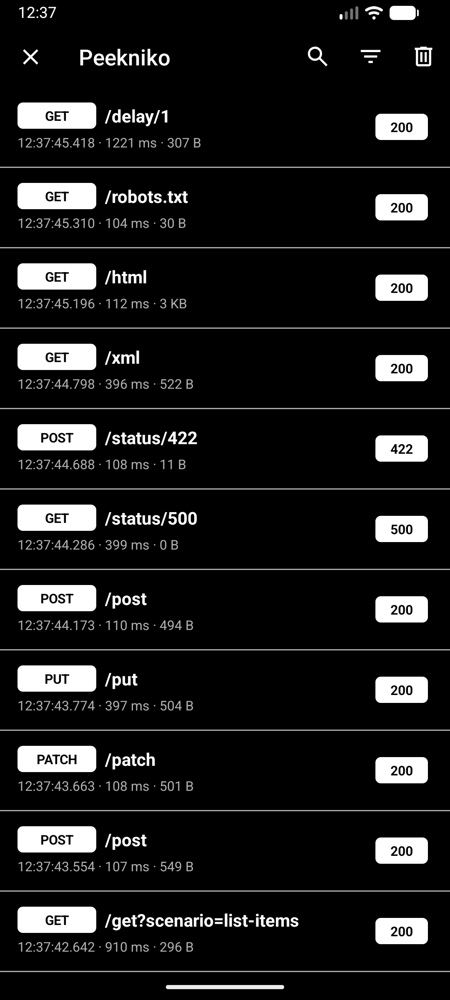
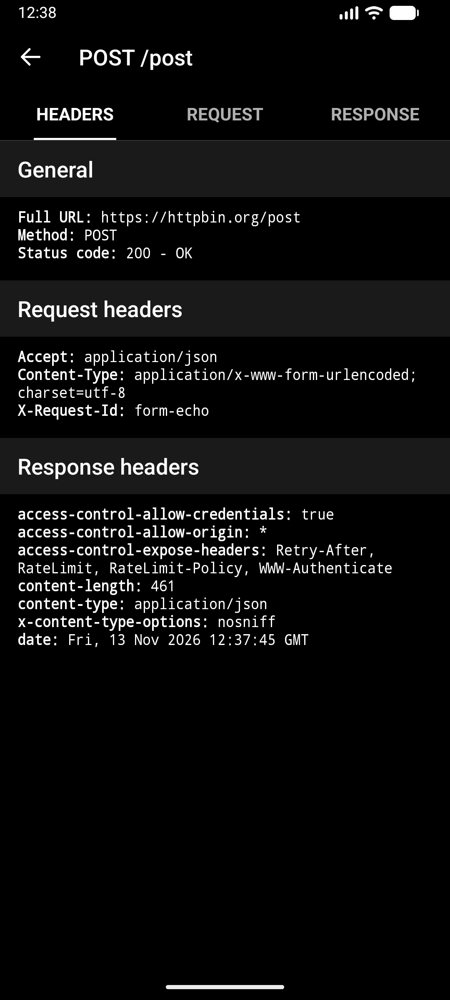
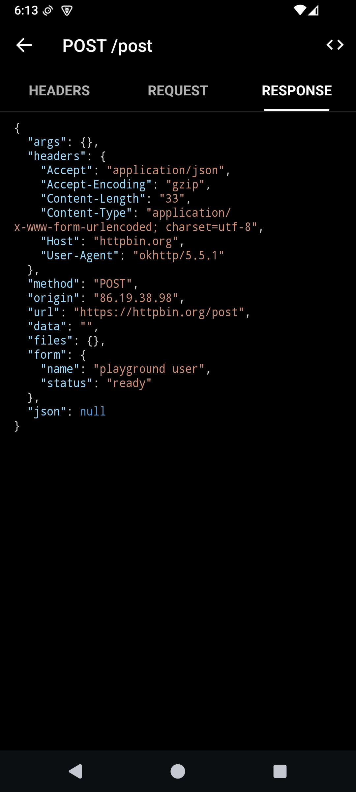

<p align="center">
  
</p>

<h1 align="center">Peekniko</h1>

<p align="center">A lightweight network inspector for your app. Capture and explore HTTP requests and responses right on your device.</p>

<p align="center">
  <a href="https://kotlinlang.org"></a>
  <a href="https://kotlinlang.org/docs/multiplatform.html"></a>
  
  
  <a href="https://search.maven.org/artifact/io.github.otacon.peekniko/client-okhttp"></a>
  <a href="LICENSE"></a>
  <a href="https://github.com/Otacon/peekniko"></a>
</p>

<p align="center">
  
  
  
</p>

## Compatibility

| Library              | Platform                        |
|----------------------|---------------------------------|
| OkHttp (Client)      | Android, Desktop                |
| Ktor (Client)        | Android, Desktop (iOS, Web WIP) |
| URLSession (Client)  | iOS (WIP)                       |
| SQLDelight (Storage) | Android, Desktop (iOS, Web WIP) |

[Documentation](https://otacon.github.io/peekniko/)

## Quick start: OkHttp + SQLDelight

Ensure Maven Central is included in `settings.gradle.kts`:

```kotlin
dependencyResolutionManagement {
    repositories {
        google()
        mavenCentral()
    }
}
```

Add the dependencies to your app module's `build.gradle.kts` (replace the version placeholders):

```kotlin
dependencies {
    debugImplementation("io.github.otacon.peekniko:client-okhttp:<peekniko-version>")
    debugImplementation("io.github.otacon.peekniko:storage-sqldelight:<peekniko-version>")
    releaseImplementation("io.github.otacon.peekniko:client-noop:<peekniko-version>")
}
```

If your app already uses SQLDelight, you don't need to add any SQLDelight dependencies. Otherwise, add them with
`debugImplementation`:

```kotlin
dependencies {
    debugImplementation("app.cash.sqldelight:runtime:<sqldelight-version>")
    debugImplementation("app.cash.sqldelight:coroutines-extensions:<sqldelight-version>")
    debugImplementation("app.cash.sqldelight:android-driver:<sqldelight-version>")
}
```

Configure persistent storage before building your OkHttp client:

```kotlin
import peekniko.Peekniko
import peekniko.storage.sqldelight.sqlDelightStorage
import peekniko.okhttp.interceptor

Peekniko.configure {
    sqlDelightStorage(name = "peekniko.db")
}

val client = OkHttpClient.Builder()
    .addInterceptor(Peekniko.interceptor)
    .build()
```
